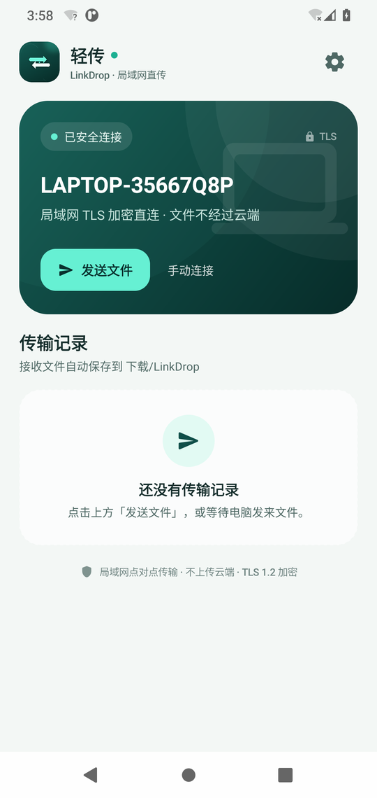
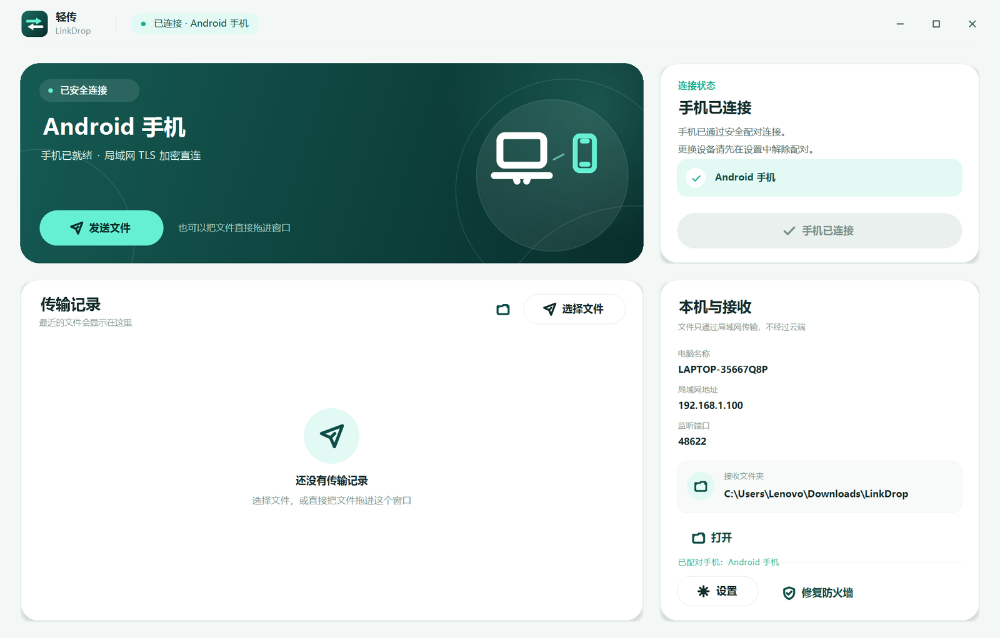

# 轻传 · LinkDrop 1.0.0

**轻传**是一款只走局域网的手机 ↔ 电脑文件互传工具。手机和 Windows 电脑通过 6 位安全码完成一次配对；此后只要两端应用都启动，就会自动重连，直接发送或接收文件。

文件在两台设备之间点对点传输，不经过服务器、不需要账号、也不会上传云端。

| Android | Windows |
| --- | --- |
|  |  |

---

## 一、功能

- **安全配对**：首次配对需要在电脑上核对 6 位安全码并明确允许。安全码由电脑 TLS 证书指纹生成，不通过输入传递。
- **自动发现与自动重连**：局域网 UDP 组播/广播发现电脑；配对信息保存后，两端启动会自动连接。找不到组播网络时支持手动 IP。
- **双向传输**：手机 → 电脑、电脑 → 手机使用同一条加密连接。
- **多文件**：手机可一次选择多个文件；电脑可多选文件或直接拖入窗口。
- **自动落盘**：手机自动保存到 <code>下载/LinkDrop</code>；Windows 默认保存到 <code>%USERPROFILE%\Downloads\LinkDrop</code>，可在设置中修改。
- **用其他应用打开**：下载完成后，点击文件卡片左侧带“↗”角标的文件图标，可交给手机里能处理该类型的其他应用查看或播放。
- **完整性校验**：传输完成后两端校验 SHA-256，临时文件不会以正式文件名出现。
- **TLS 1.2 加密**：配对后使用固定证书指纹和 256 位配对令牌鉴权，连接不能被局域网内的其他设备冒充。
- **中文界面、深色/浅色跟随系统**（Android）；Windows 使用 100%–200% 高 DPI 自适应布局。

支持的平台：

| 平台 | 要求 |
| --- | --- |
| Android | Android 10（API 29）及以上，ARM64 / x86_64 |
| Windows | 64 位 Windows 10 / 11，.NET Framework 4.8（系统自带） |

---

## 二、安装

### Android

安装包：<code>dist/LinkDrop-Android-1.0.0.apk</code>

- 在手机上打开 APK，允许“安装未知应用”后安装。
- 或使用 adb：<code>adb install -r LinkDrop-Android-1.0.0.apk</code>。
- APK 使用本项目 release keystore 签名；签名证书 SHA-256 指纹为：
  <code>70:D9:82:6C:E8:1A:55:3A:AD:F8:03:81:C9:BE:A8:B9:86:3B:BE:9B:A7:3F:91:B2:7B:1E:6C:BF:6D:E7:71:FC</code>

应用仅申请网络、Wi-Fi 状态和组播相关权限；没有存储权限，文件通过系统 <code>MediaStore</code> 写入公共下载目录。

### Windows

Windows 包：<code>dist/LinkDrop-Windows-1.0.0.zip</code>

1. 把 ZIP 解压到一个固定目录（不要只把 exe 单独复制出来，旁边需要 <code>BouncyCastle.Crypto.dll</code> 和 <code>LinkDrop.exe.config</code>）。
2. 双击 <code>LinkDrop.exe</code>。
3. 首次启动如弹出 Windows 防火墙提示，请允许“专用网络”。
4. 如果没有弹窗或手机连不上，打开应用内“设置 → 修复防火墙”，按提示授予管理员权限。应用会为自身 exe 添加**专用/域网络**入站放行规则。

这是便携式程序，不需要安装；但会在 <code>%LOCALAPPDATA%\LinkDrop</code> 保存设备身份、配对令牌哈希和日志。

> Windows 可执行文件未做商业代码签名，部分系统可能出现 SmartScreen 提示。请选择“更多信息 → 仍要运行”，或自行使用代码签名证书签名。
>
> 电脑的网络位置需要是“专用网络”。如果被识别为“公用网络”，Windows 防火墙默认会阻止手机连接。

---

## 三、首次配对（通过安全码匹配）

前置条件：手机和电脑连接同一个 Wi-Fi / 局域网；关闭路由器的“AP 隔离”或访客网络隔离。

1. **电脑端**打开轻传，点击右侧卡片中的 **生成安全码**。电脑会显示一个 6 位安全码并进入 120 秒配对模式。
2. **手机端**打开轻传：
   - 正常情况下，“附近的电脑”会显示这台电脑（电脑正在配对时会显示“可配对”）。
   - 如果没看到，点击“手动连接 / 输入 IP”，填写电脑主界面“本机与接收”卡片上显示的 **局域网地址** 和 **端口**（默认 <code>48622</code>）。
3. 在手机上选择这台电脑。手机会通过 TLS 连接到电脑，并显示 **电脑屏幕上的同一个 6 位安全码**。
4. 核对两块屏幕上的安全码完全一致，然后在电脑的配对窗口点击 **允许配对**。
5. 两端显示“配对成功”。手机会自动建立工作连接；以后只要两端都打开轻传，就会自动重连。

> 安全码每台电脑固定（由该电脑的 TLS 证书指纹生成），但它本身不是密码，不能单独用于连接。真正的授权还必须经过电脑端用户点击“允许配对”。

### 配对后日常使用

1. 打开电脑端轻传（无需再次输入任何内容）。
2. 打开手机端轻传。
3. 手机顶部显示“已安全连接”，或电脑端显示“手机已连接”后即可传文件。
   - 手机发送：点击 **发送文件** → 选择一个或多个文件。
   - 电脑发送：点击 **发送文件**，或直接把文件拖到窗口里。
4. 接收端自动保存并校验文件。两端传输记录会实时显示进度。

默认保存位置：

- Android：<code>下载/LinkDrop</code>（在系统“文件”应用中可见）
- Windows：<code>C:\Users\用户名\Downloads\LinkDrop</code>（可在设置中修改）

Android 中点击已保存文件左侧的文件图标，即可用其他应用打开；系统没有可处理该类型的应用时会提示。Windows 中双击已完成的记录可打开文件。

---

## 四、安全与隐私

- **不经过云端**：没有中转服务器、没有账号系统、没有遥测和广告 SDK。文件只在手机和电脑之间直接传输。
- **配对证书**：Windows 端首次启动生成一张仅存于本机的自签名 RSA-2048 证书；证书密码由 Windows DPAPI 加密保护。
- **固定指纹**：手机首次配对时记录电脑证书的 SHA-256 指纹，以后每次连接都会校验；证书变化会被拒绝并提示重新配对。
- **配对令牌**：配对成功后电脑生成 256 位随机令牌交给手机；电脑只保存令牌的 SHA-256 哈希。连接时必须同时匹配设备 ID 和令牌。
- **TLS 1.2**：局域网内传输内容加密；没有明文文件传输。
- **安全码匹配**：安全码是电脑证书指纹的一部分，手机和电脑同时显示，用来发现中间人证书替换。电脑端还必须由用户明确点击允许。
- **文件校验**：每个文件以临时文件接收，完整收到后校验 SHA-256，再原子移动到下载目录。
- **备份**：Android 的配对数据已排除在系统备份之外；Windows 配对记录不包含可用明文令牌。

> 这不能替代企业级 PKI。请只在可信的局域网中使用。若需要跨公网，应使用 VPN 或成熟的企业传输方案，不要直接把端口暴露到公网。

---

## 五、故障排查

### 手机看不到电脑

- 两端必须处于**同一个** Wi-Fi / 子网。手机流量、电脑 VPN、访客网络可能不是同一网络。
- 确认电脑网络配置文件是“专用网络”，或执行“设置 → 修复防火墙”。
- 某些路由器/AP 会拦截组播或开启 AP 隔离；此时使用手机的 **手动连接**，输入电脑界面显示的 IP 和端口。
- 点击手机上的“重新扫描”。

### 电脑显示已配对但手机连不上

- 确认电脑端轻传正在运行，且没有另一个实例占用端口。
- 在手机设置中解除配对，再在电脑端重新配对，可以重建两侧的令牌。
- 如果电脑重装或删除了 <code>%LOCALAPPDATA%\LinkDrop</code>，证书会变化，必须重新配对。

### 安全码不一致 / 提示证书变化

- 不要继续。取消这次配对，检查是否有陌生设备，或网络被劫持。
- 如果是自己重装了系统/清除了电脑身份，在手机端解除配对后重新配对即可。

### 文件收不到

- 保持两端应用处于前台/屏幕点亮，Android 在后台可能被系统挂起。
- 检查接收端存储空间。
- Windows 端检查接收目录权限；Android 端检查 <code>下载/LinkDrop</code> 是否存在。
- 查看 Windows 日志：<code>%LOCALAPPDATA%\LinkDrop\linkdrop.log</code>。

### Windows 无法启动 / 端口被占用

- 需要 .NET Framework 4.8。
- 默认 TCP 端口为 48622，被占用时会自动尝试 48623–48632；端口会显示在界面中。
- 可结束残留的 LinkDrop 进程后重启。

---

## 六、从源码构建

源码包：<code>dist/LinkDrop-1.0.0-source.zip</code>

### Android

需要：

- JDK 17
- Android SDK Platform 35、Build-Tools 35.0.0
- Gradle 8.13（工程自带 wrapper）

在 <code>android/local.properties</code> 中设置本机 SDK：

<pre><code>sdk.dir=C\:/path/to/Android/Sdk</code></pre>

构建 debug：

<pre><code>cd android
gradlew.bat :app:assembleDebug</code></pre>

构建 release：

1. 准备自己的签名 keystore；
2. 在 <code>android/keystore.properties</code> 中填写：
   <pre><code>storeFile=keystore/your-release.jks
storePassword=...
keyAlias=...
keyPassword=...</code></pre>
3. 执行：
   <pre><code>gradlew.bat :app:assembleRelease</code></pre>

没有 <code>keystore.properties</code> 时，release 回退使用 debug 签名，仅便于本地验证。

### Windows

需要 64 位 .NET Framework 4.8（Windows 10/11 自带）。不需要 Visual Studio 或 .NET SDK。

<pre><code>cd windows
build.cmd</code></pre>

<code>build.cmd</code> 会调用 Windows 自带的 C# 编译器，并复制 <code>BouncyCastle.Crypto.dll</code> 到输出目录。

- 入口：<code>windows/src/Program.cs</code>
- 主要 UI：<code>MainForm.cs</code>、<code>PairingForm.cs</code>、<code>SettingsForm.cs</code>
- 网络与协议：<code>PeerSession.cs</code>、<code>DiscoveryService.cs</code>、<code>Protocol.cs</code>
- 输出：<code>build/windows/LinkDrop.exe</code>

### 测试

Windows 协议集成测试覆盖 TLS 握手、安全码、配对批准、令牌鉴权、双向文件传输、SHA-256 校验和错误令牌拒绝，测试源码在 <code>windows/tests/IntegrationTest.cs</code>。使用显式入口 <code>/main:LinkDrop.Tests.Program</code> 构建运行。

---

## 七、项目结构

<pre>
LinkDrop/
├─ android/                 Android 应用（Kotlin + Jetpack Compose）
│  └─ app/src/main/java/com/qingchuan/linkdrop/
│     ├─ data/              设置、配对信息、UI 数据模型
│     ├─ net/               发现、TLS、配对、双向传输
│     ├─ storage/           MediaStore 下载目录写入
│     └─ ui/                Compose 界面、对话框、ViewModel
├─ windows/                 Windows 桌面端（C# / .NET Framework 4.8 / WinForms）
│  ├─ src/                  程序、UI、发现、TLS 会话、协议
│  ├─ tests/                协议集成测试
│  └─ vendor/               BouncyCastle 证书生成依赖
├─ docs/
│  ├─ protocol.md           协议与帧格式
│  ├─ TESTING.md            验证记录
│  └─ images/               截图
├─ assets/                  图标与生成脚本
├─ tools/test_phone.py      端到端联调用的手机模拟器脚本（开发辅助）
└─ README.md
</pre>

协议细节见 [docs/protocol.md](docs/protocol.md)。

---

## 八、验证记录（摘要）

- Windows 协议集成测试：**20 / 20 通过**。
- Android release APK：签名验证通过，安装并运行于 Android 11（API 30）x86_64 模拟器。
- 首次配对：手机与电脑安全码一致（942176），电脑允许后手机自动连接。
- 双向传输：
  - 电脑 → 手机：<code>电脑桌布.jpg</code>（1.5 MB）、<code>发布测试.txt</code>（87 B）保存到 <code>下载/LinkDrop</code>。
  - 手机 → 电脑：同名文件回传并保存到 <code>Downloads\LinkDrop</code>。
  - 两端 SHA-256 完全一致（详见 <code>docs/TESTING.md</code>）。
- 文件图标外跳：点击已下载图片的图标，系统调起 <code>com.android.gallery3d</code>，以 <code>content://</code> + <code>image/jpeg</code> 成功打开原图。
- 自动重连：
  - Windows 重启后约 3 秒手机自动重连。
  - Android 应用重启后约 2 秒自动重连。
- 发现服务：通过同一端口注入 IPv4 UDP 信标，Android 能正确显示“DISCOVERY-TEST”并标记“可配对”。

详细测试记录和已知边界见 [docs/TESTING.md](docs/TESTING.md)。

---

## 九、已知限制

- 仅支持同一 IPv4 局域网；不支持公网直连、NAT 穿透或中继。
- 电脑同一时间只保留一台已配对手机；手机只保留一台已配对电脑。重新配对会替换旧记录。
- Android 应用被系统完全杀死后需要重新打开应用才能恢复连接；后台传输可能被厂商省电策略挂起。
- 传输中断不会自动续传，需要重新选择文件。
- 传输历史保存在内存中，重启应用后清空；已接收的文件仍在下载目录。
- Android UI 采用单列手机布局；Windows 窗口可最大化，但不支持自由拖动缩放。
- Windows 可执行文件未签名，SmartScreen 可能提示；发布到团队/商店前应自行签名。
- 目前只在 Android 11 模拟器上完成了端到端验证。真实手机 + 真实 Wi-Fi 的组播发现仍建议按“首次配对”流程实测一次；无法发现时使用手动 IP 兜底。

---

## 十、版本与第三方

- 轻传 LinkDrop 1.0.0（2026-10-20）
- Android：Kotlin 2.1.21、Jetpack Compose、AGP 8.10.0、Gradle 8.13、minSdk 29、target/compileSdk 35
- Windows：.NET Framework 4.8、WinForms、BouncyCastle 1.8.9（MIT-style license，见 <code>windows/vendor/NOTICE.txt</code>）
